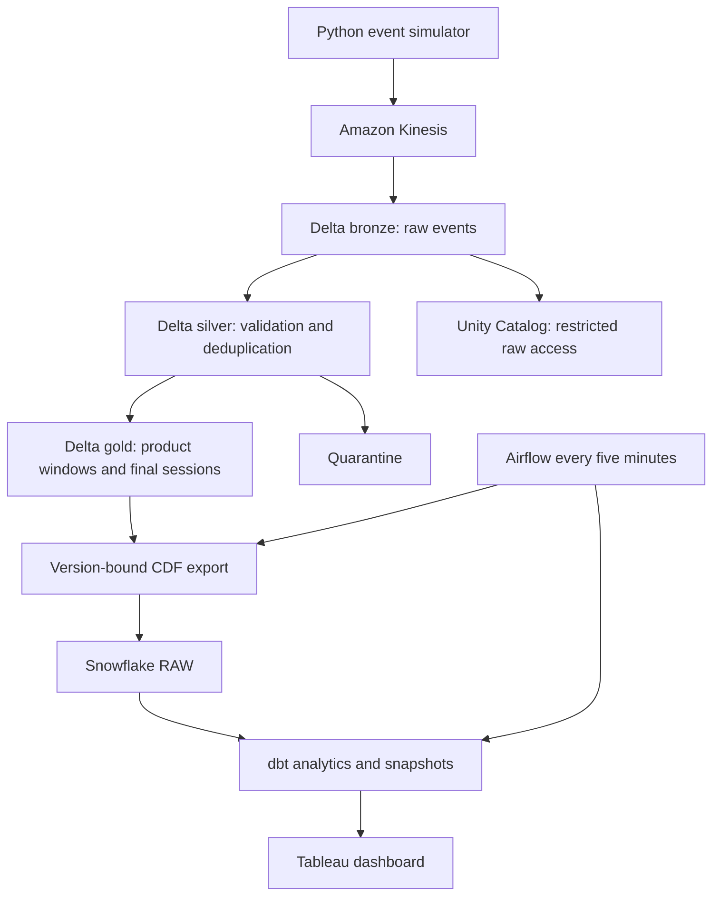

# Real-Time Clickstream Analytics Lakehouse

A portfolio implementation of an e-commerce analytics platform: synthetic events → Amazon Kinesis → Scala Structured Streaming → Unity Catalog / Delta Lake → Snowflake → dbt → Tableau. Airflow schedules exports and modeling; GitHub Actions validates the repository.

**Status:** runnable local reference demo plus cloud deployment source. Cloud resources, throughput, Databricks jobs, Snowflake models and Tableau publication require account-specific deployment and have **not** been validated end to end. **5,000 events/sec is a load target, not a measured result.** See [validation](docs/VALIDATION.md).

## Run locally in one minute

Requires Python 3.10+; the reference demo uses only the standard library.

```bash
python -m unittest discover -s tests -v
python -m clickstream.demo
python -m clickstream.generator --count 10000
```

Outputs in `build/`: `summary.json`, `sessions.csv`, `products.csv` and `events.jsonl`. The demo injects 100 duplicate events and one invalid event into 10,000 synthetic events. It performs finite-data deduplication, sessions, ordered funnels and product aggregates. It does **not** emulate distributed processing or watermark eviction.

## Architecture



## What is implemented

| Component | Implementation |
|---|---|
| Producer | Synthetic journeys, stable IDs, integer money, concurrent batches, partial-failure retry, achieved-throughput measurement |
| Kinesis | Terraform stream, encryption, eight configurable shards, IAM policies and shard metrics |
| Bronze | Scala Kinesis source, raw JSON, durable Delta checkpoint |
| Silver | Contract checks, quarantine, future-time guard, two-minute watermark, bounded event-ID deduplication, email removal |
| Gold | One-minute product aggregates with idempotent MERGE; 30-minute inactivity sessions with ordered funnel stages |
| Governance | UC schema grants, masked contact lookup and quarantine columns; gold exports exclude raw user IDs and emails |
| Snowflake | Key-pair authentication, Delta CDF version cursor, per-table transaction for MERGE plus cursor advancement |
| dbt | Incremental fact models, daily product and funnel views, SCD2 example catalog snapshot, schema and singular tests, docs |
| Orchestration | Airflow export → dbt build/docs → source freshness; no overlapping scheduled exports |
| Tableau | Editable Snowflake-connected workbook template, dashboard layout, publication helper and setup guide |
| CI | Unit tests, local demo artifact, Python compilation, dbt parse and Terraform validation |

## Metrics and freshness

- **Product windows:** provisional one-minute aggregates updated on a 10-second streaming trigger. Snowflake/dbt refresh every five minutes **plus compute time**, so the dashboard is minutes-level near real time, not subsecond.
- **Sessions:** each new event extends a 30-minute inactivity window. Final results appear only when the event-time watermark passes its end: normally at least 32 minutes after the last event, plus export delay. If new events stop, event-time watermarks may stop advancing too.
- **Ordered funnel:** product view → add to cart → checkout → purchase, within one visitor session. It is a session funnel, not product-specific attribution. Earlier out-of-order arrival is sorted by event time, with event ID breaking ties.
- **Conversion rate:** converted sessions / sessions with product views. Zero denominator returns NULL.
- **Product purchases per view:** purchase event count / view event count; it can exceed 1 and must not be labeled visitor conversion.
- **Money:** integer USD cents, converted only for presentation. Purchases are single-product orders. Refunds, multi-currency, cross-device identity and multi-line orders are outside this version.

## Deploy

Follow [the deployment runbook](docs/DEPLOYMENT.md). You need AWS, a Unity Catalog-enabled Databricks workspace, Snowflake and Tableau Server/Cloud or Desktop. No credentials belong in git. Terraform creates billable resources only when you explicitly run `apply`.

## Reliability boundaries

Kinesis/producer delivery is at-least-once. Deduplication is bounded by a two-minute event-time watermark, not a permanent uniqueness index. Replays older than the state horizon require controlled rebuilds, not ordinary live ingestion. An order retransmitted with a **new** event ID is not deduplicated. Session state retains an array of events: long-running high-volume visitor sessions can be large; cap abusive visitors upstream or replace it with a compact custom state machine before production scale.

Gold exports are insert/update only. Deletes and historical corrections require a coordinated rebuild. Delta CDF retention must exceed maximum export outage. A missing CDF interval fails rather than silently skipping data. Keep checkpoints, schema versions and cursor state together. Never reset just one of them.

## Repository map

- `clickstream/`, `tests/`: simulator, local reference analytics and tests
- `infra/`: AWS Terraform
- `databricks/`, `databricks.yml`: Scala notebooks, Python export, governance and job bundle
- `snowflake/`, `dbt/`: warehouse bootstrap and modeling
- `airflow/`: scheduled bounded export and modeling DAG
- `tableau/`: workbook template and publication helper
- `docs/`: deployment, failure handling, benchmark procedure, validation and references

This is a synthetic portfolio project, not a claim of production deployment at an employer.
